# Fishers Tigers Lacrosse Scorebook — Scorekeeper Startup Guide

Welcome! This guide gets you set up to keep score. You only have to do the
one-time setup **once** on your device. After that, you'll just open the app and
start the game.

Total setup time: about 5 minutes.

---

## What you'll need before you start

- A phone, tablet, or laptop with internet.
- The **app web address**: https://drewcollier.github.io/lax_scorebook/
- The **Script Link** (a long web address I will send you — this connects the
  app to our team's stats sheet).
- The **Stats PIN** (a short number I will send you — needed to save a game).

> Keep the Script Link and PIN handy. You'll paste them in during setup.

---

## Part 1 — One-time setup (do this once per device)

### Step 1: Open the app

1. Open your web browser (Chrome, Safari, Edge — whatever you normally use).
2. Go to **https://drewcollier.github.io/lax_scorebook/**
3. You should see the scorebook with four buttons across the top:
   **Game**, **Roster**, **History**, and **Settings**.

> **Tip — add it to your home screen (optional but handy):**
> - **iPhone/iPad:** tap the Share button, then "Add to Home Screen."
> - **Android:** tap the menu (three dots), then "Add to Home screen."
>   This gives you a tap-to-open icon so you don't have to type the address again.

### Step 2: Connect the app to our stats sheet

1. Tap the **Settings** button at the top.
2. Find the box labeled **"Google Apps Script URL."**
3. **Paste the Script Link** I sent you into that box.
   - To paste: tap and hold inside the box, then choose **Paste**.
4. Tap **Save**.

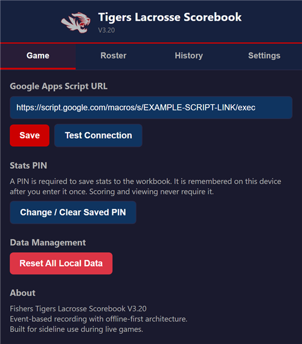

### Step 3: Make sure the connection works

1. Still on the **Settings** screen, tap **Test Connection**.
2. You should see a small message confirming it connected.
   - ✅ **If it says connected** — you're good, go to Step 4.
   - ❌ **If it shows an error** — double-check you pasted the **entire** Script
     Link (they're long and easy to cut off). Re-paste it, tap **Save**, and try
     **Test Connection** again. If it still fails, contact me.

### Step 4: Load the team roster

1. Tap the **Roster** button at the top.
2. Tap **Pull Roster from Sheets**. The player list fills in automatically.
3. Tap **Pull Officials from Sheets** (this loads the referee/officials names
   you'll pick from before a game).

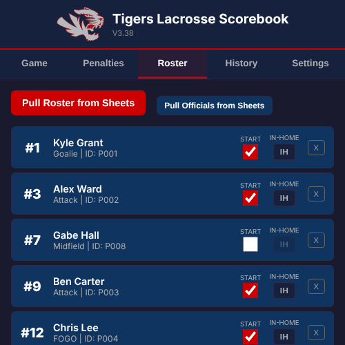

That's it — setup is done. You won't need to repeat Parts 1–4 on this device.

---

## Part 2 — Getting ready for a game

Do this shortly before game time.

### Step 1: Open the app and check the roster

1. Open the app (tap your home-screen icon, or go to the web address).
2. Tap **Roster** and confirm the players are listed.
   - If the list looks empty or out of date, tap **Pull Roster from Sheets**
     again to refresh it.

### Step 2: Set up the game

1. Tap the **Game** button at the top.
2. Fill in the game details:
   - **Opponent name**
   - **Date** (it usually defaults to today)
   - **Location** (Home or Away)
3. Tap **Start Game**.
4. A short pop-up appears to capture game details (weather, officials, start
   time, etc.). Fill in what you know and tap **Start Game** again to begin.
   - Anything you're unsure of can be left as-is.

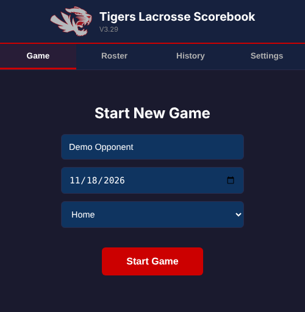

You're now ready to score the game. 🥍

---

## Part 3 — Scoring the game

The app works the way stats are called out: **Stat, Player, Time (only if needed)**.
For example: "Ground ball, number 3." Or: "Goal, number 27, assisted by number 9,
time 11:15."

On the **Game** tab, make sure **By Stat** is selected at the top of the screen.

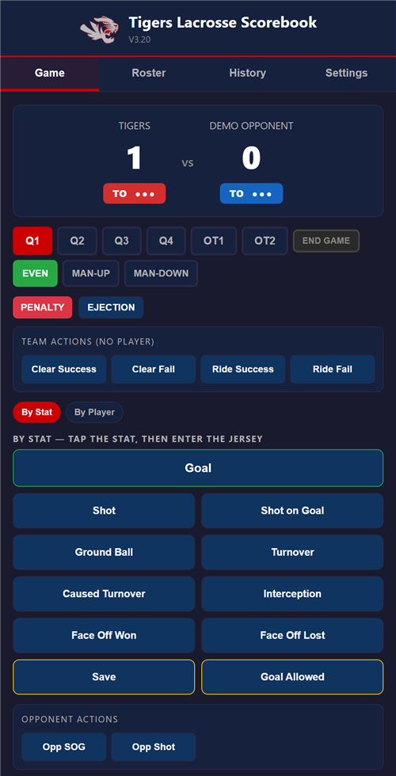

### Recording a stat

1. Tap the stat (for example **Ground Ball**).
2. Tap the jersey number on the keypad (one or two digits), then tap **OK**.

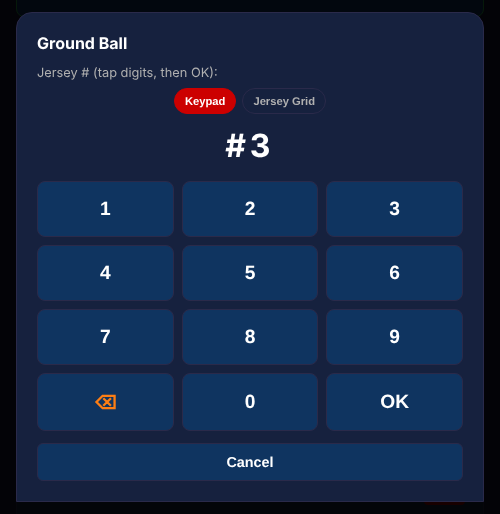

That's it. The stat shows up in the Event Log at the bottom of the screen.

| Stat | What happens after you enter the jersey |
|---|---|
| Ground Ball, Turnover, Caused Turnover, Interception | Recorded right away |
| Face Off Won, Face Off Lost | Recorded right away |
| Save | Recorded right away (goalies only) |
| Goal Allowed | Asks for the time on the clock (goalies only) |
| Shot | Asks where the shot was taken from |
| Shot on Goal | Counts a shot too. Asks where the shot was taken from |

> **Shot location is the least important detail.** If you missed it, tap **Skip**.

### Recording a goal

Enter it in the same order it is called out:

1. Tap **Goal**.
2. Enter the **scorer's** jersey number, tap **OK**.
3. Enter the **assist** jersey number and tap **OK**, or tap **No Assist**.
4. Enter the **time on the clock** as four digits (for example **0934** for 9:34), tap **OK**.
   The time is required for every goal.
5. Tap the **shot location**, or tap **Skip**.

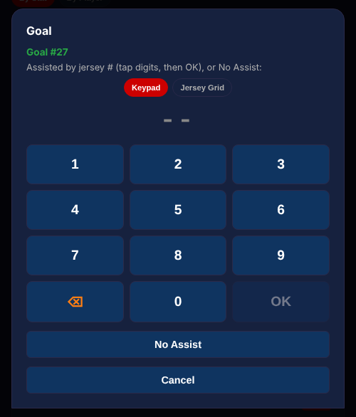

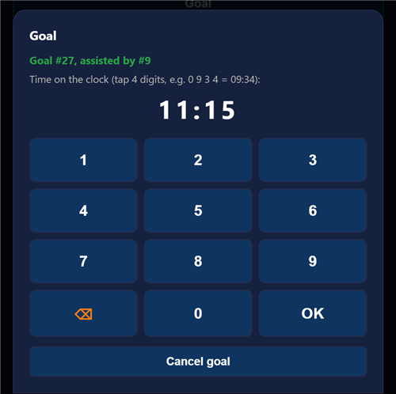

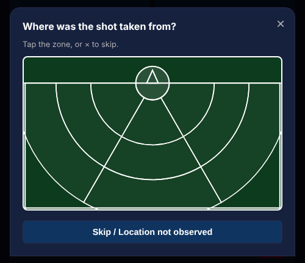

The goal also counts as a shot and a shot on goal automatically. Do not enter those
separately. Nothing is saved until the last step, so if you tap **Cancel** before
then, no goal is recorded.

### If the app says a jersey number doesn't exist

The message "Jersey # doesn't exist on the roster" means that number is not on
your roster. Tap **Re-enter** to try again, or **Cancel**. If the number is right,
the roster may be out of date. Pull it again (see Part 2).

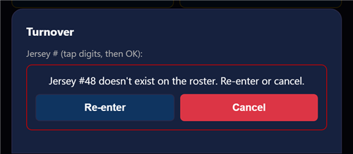

### Penalties

Penalties work in the same order as everything else.

1. Tap **PENALTY** and pick the team (and the player for the Tigers).
2. Enter the **time on the clock** when the penalty was called (four digits, for
   example **0845**). Take care with this one. The app uses it to work out how
   much of the penalty has been served.
3. Pick the penalty, then the **duration**.
4. For a **personal foul**, a **Locked in** box appears. Tick it when the penalty
   is non-releasable, which means a goal will **not** release it. Technical fouls
   can never be locked.

Every active penalty appears in the **Active penalties** box, under the quarter
buttons.

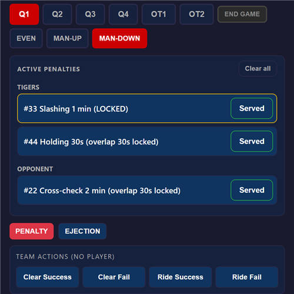

- **EVEN, MAN-UP and MAN-DOWN are indicators, not buttons.** The app works them
  out from the penalties in the box, so you never tap them. If both teams have a
  penalty it shows **EVEN (1 v 1)**. Two penalties against one team shows
  **MAN-DOWN (2)**.
- **When a penalty ends, tap Served** next to it. The app does not run a clock, so
  it relies on you for this. **Clear all** removes every penalty and asks you to
  confirm first.
- **Penalties called at the same time against both teams** show "overlap locked".
  The shared time cannot be released by a goal.

### What a goal does to penalties

After you enter the goal's time, the app compares it with when each penalty started.

- Penalties on the team that was **scored on** are released, unless they are locked
  or still inside their overlap time.
- The team that **scored** keeps its own penalties.
- If a penalty had already run out (you forgot to tap Served), a **"Penalty already
  expired"** message appears. Tap **OK**. That goal is not counted as a man-up or
  man-down goal, and the strength goes back to what is really left.
- **Undo** on the goal puts back every penalty it released or cleared.
- If you tap **Cancel (leave blank)** on the goal time, nothing is released.

### Other options

- **Jersey Grid:** if you would rather tap a player than type a number, tap
  **Jersey Grid** at the top of the jersey screen. The app remembers your choice
  on this device. Tap **Keypad** to switch back.
- **By Player:** tap **By Player** at the top of the Game tab to see player cards.
  Tap a player first, then the stat.
- **Ejections:** use the **EJECTION** button, same as always.
- **Fixing a mistake:** find the entry in the Event Log and tap **Undo**.

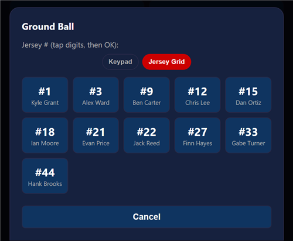

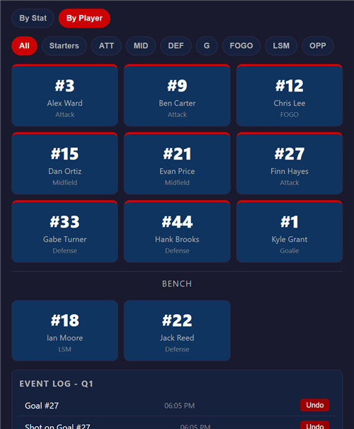

---
## Part 4 — Saving the game (the PIN)

When the game ends and you save it to the team sheet, the app will ask for the
**Stats PIN** the first time on your device.

1. When prompted, type the **Stats PIN** I sent you.
2. The app remembers it on that device, so you won't be asked again.

> **Why the PIN?** It protects our official stats so only our scorekeepers can
> save games. Viewing the app, loading the roster, and keeping score never need
> the PIN — only **saving** a finished game does.

If you ever mistype it or need to change it:
- Go to **Settings** → **Stats PIN** → **Change / Clear Saved PIN**.

---

## Quick troubleshooting

| What you see | What to do |
|---|---|
| "Set Apps Script URL in Settings first" | You skipped Part 1, Step 2. Go to **Settings**, paste the Script Link, tap **Save**. |
| Roster is empty | Tap **Roster** → **Pull Roster from Sheets**. |
| **Test Connection** fails | Re-paste the **full** Script Link (they get cut off easily), tap **Save**, try again. |
| App looks like an old version | Fully close the browser and reopen it. |
| "Jersey # doesn't exist on the roster" | That number is not on the roster. Tap **Re-enter**, or pull the roster again if it is out of date. |
| EVEN / MAN-UP / MAN-DOWN won't respond when tapped | They are indicators. Add or remove penalties in the **Active penalties** box and they update on their own. |
| "Penalty already expired" message after a goal | A penalty had run out before the goal. Tap **OK**. Next time, tap **Served** when a penalty ends. |
| Game won't save / asks for PIN | Type the **Stats PIN** I sent you. If rejected, use **Settings → Stats PIN → Change / Clear Saved PIN** and re-enter it. |

---

## Game-day checklist

- [ ] App opens and shows the four tabs
- [ ] Roster is loaded and current
- [ ] Opponent, date, and location entered on the **Game** tab
- [ ] **By Stat** is selected on the Game tab
- [ ] Stats PIN handy for saving at the end

**Questions or anything looks off? Contact Drew Collier: 317-658-4777 or andrew.collier@gmail.com**
